<div align="center">
  

  <p><code>Secure admin console for managing hospital doctors and patients with a live analytics dashboard</code></p>

  <p>
    <a href="https://doctor-tracker-web.vercel.app"></a>
    <a href="https://doctor-tracker-backend-jn3d.onrender.com/health"></a>
    <a href="https://github.com/Saji-d/doctor-tracker"></a>
    
  </p>

  <p>
    
    
    
    
    
    
    
    
  </p>

  <p>
    <a href="#-overview">Overview</a> · <a href="#-try-it-live">Try it live</a> · <a href="#-highlights">Highlights</a> · <a href="#-preview">Preview</a> · <a href="#-architecture">Architecture</a> · <a href="#-tech-stack">Tech Stack</a> · <a href="#-getting-started">Getting Started</a> · <a href="#-roadmap">Roadmap</a>
  </p>
</div>


## ◈ Overview

Doctor Tracker lets hospital front-desk staff manage doctors and their patients in one place. Register doctors, add patients under them, reassign patients between doctors and search, filter and paginate both lists. A live dashboard summarises headcounts, per-doctor patient loads, condition breakdowns and registration trends.

It is one Git repository with two independently deployed apps: a Next.js frontend on Vercel and an Express and MongoDB REST API on Render, talking over HTTPS across two hosts.


## ◈ Try it live

<div align="center">
  <a href="https://doctor-tracker-web.vercel.app"></a>
</div>

<br>

| Role | Email | Password |
| :--- | :--- | :--- |
| **Admin** | `admin@doctortracker.dev` | `admin1234` |

> The API runs on Render's free tier and spins down after inactivity, so the first request after a pause can take up to about 50 seconds. This is expected.


## ◈ Highlights

<table>
<tr>
<td width="33%" valign="top"><b>Doctor management</b><br>Create, edit and delete doctors with full-text search and specialization, hospital and date filters.</td>
<td width="33%" valign="top"><b>Patient management</b><br>A cross-doctor patients page with inline edit and reassignment to another doctor.</td>
<td width="33%" valign="top"><b>URL-synced filters</b><br>Filters and pagination live in the URL so views can be shared and reloaded.</td>
</tr>
<tr>
<td valign="top"><b>Analytics dashboard</b><br>Totals, patients per doctor, condition breakdown, recent patients and 7, 30 or 90 day trends with Recharts.</td>
<td valign="top"><b>Backend-enforced auth</b><br>JWT in an httpOnly cookie, no public sign-up and every protected route verifies the session itself.</td>
<td valign="top"><b>Hardened API</b><br>helmet, locked CORS, Zod validation, a login rate limit of 5 attempts per 15 minutes per IP and one central error handler.</td>
</tr>
<tr>
<td valign="top"><b>Indexed queries</b><br>Text, filter and compound indexes keep paginated lists fast.</td>
<td valign="top"><b>Tested</b><br>Jest and Supertest integration tests against in-memory MongoDB plus frontend component tests.</td>
<td valign="top"><b>Responsive</b><br>Checked at a 390px viewport with a collapsing mobile menu.</td>
</tr>
</table>


## ◈ Preview

<div align="center">
  
</div>

<br>

<table>
<tr>
<td width="50%"><b>Dashboard</b><br>Stat cards, charts and condition breakdown<br>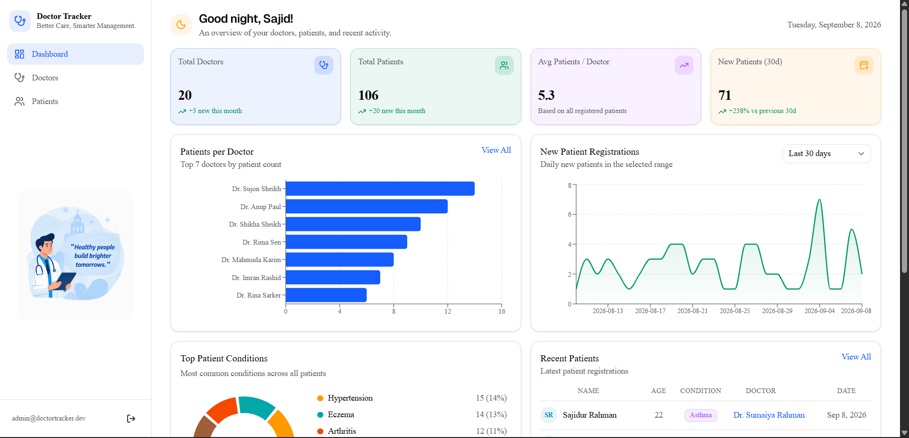</td>
<td width="50%"><b>Doctors</b><br>Search, filters and pagination<br>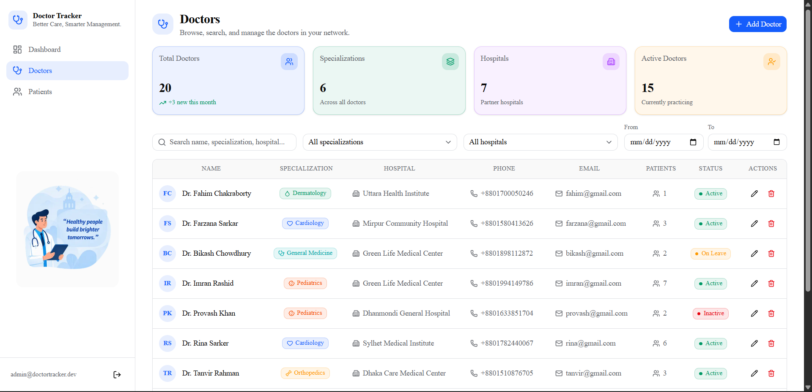</td>
</tr>
<tr>
<td><b>Doctor detail</b><br>That doctor's patients, add and delete inline<br>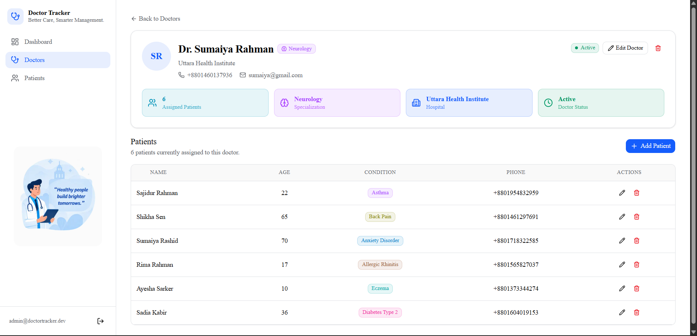</td>
<td><b>Patients</b><br>Cross-doctor view with inline edit and reassign<br>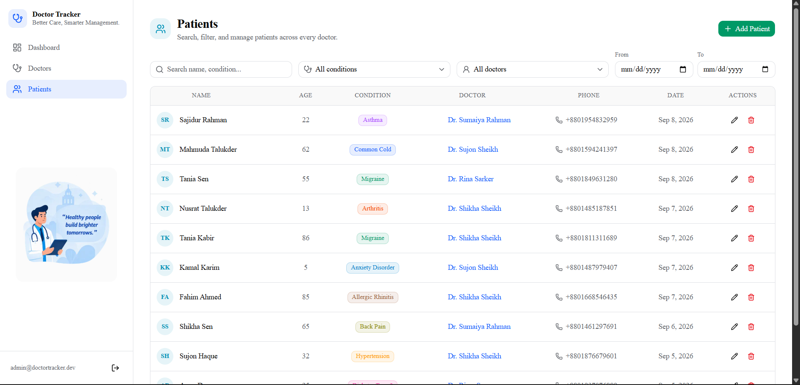</td>
</tr>
</table>

<details>
<summary><b>More screens: landing, login, forms and mobile</b></summary>

<table>
<tr>
<td width="50%"><b>Landing</b><br>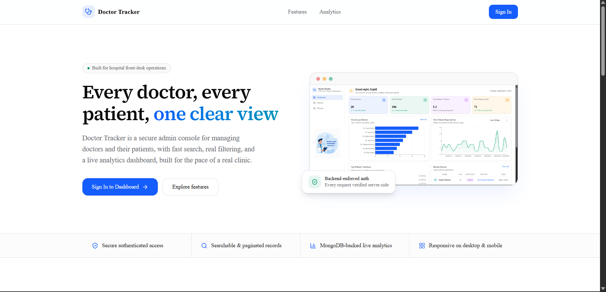</td>
<td width="50%"><b>Login</b><br>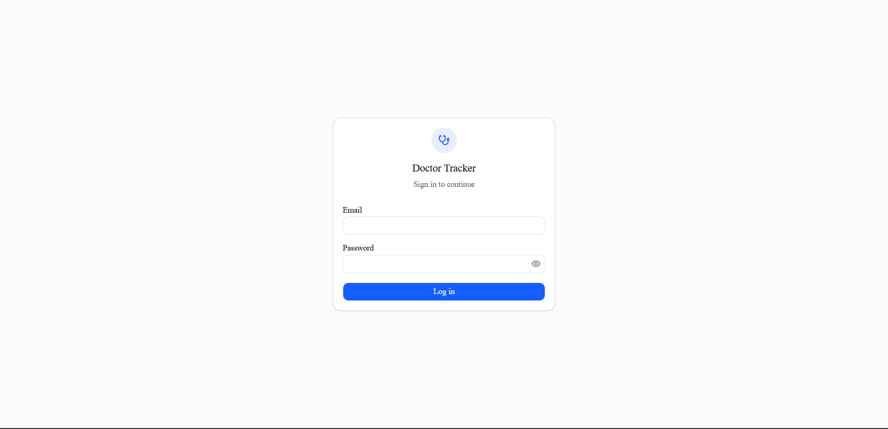</td>
</tr>
<tr>
<td><b>Add doctor</b><br>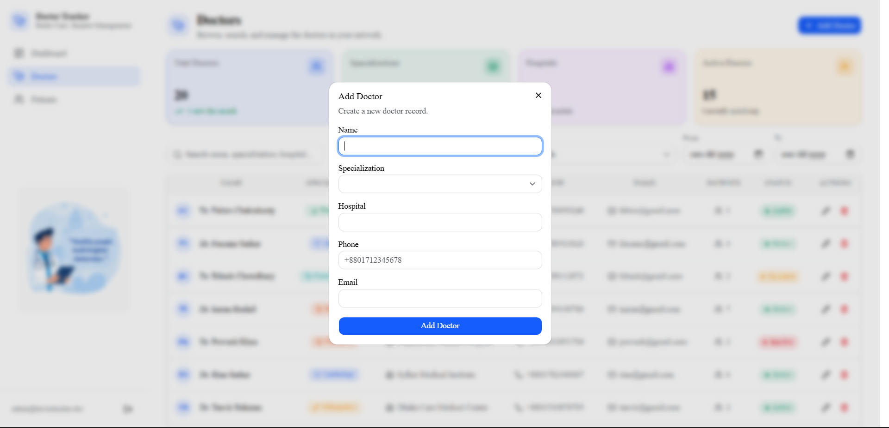</td>
<td><b>Add patient</b><br>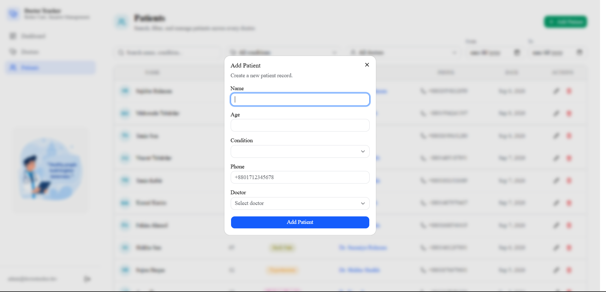</td>
</tr>
</table>

<table align="center">
<tr>
<td align="center">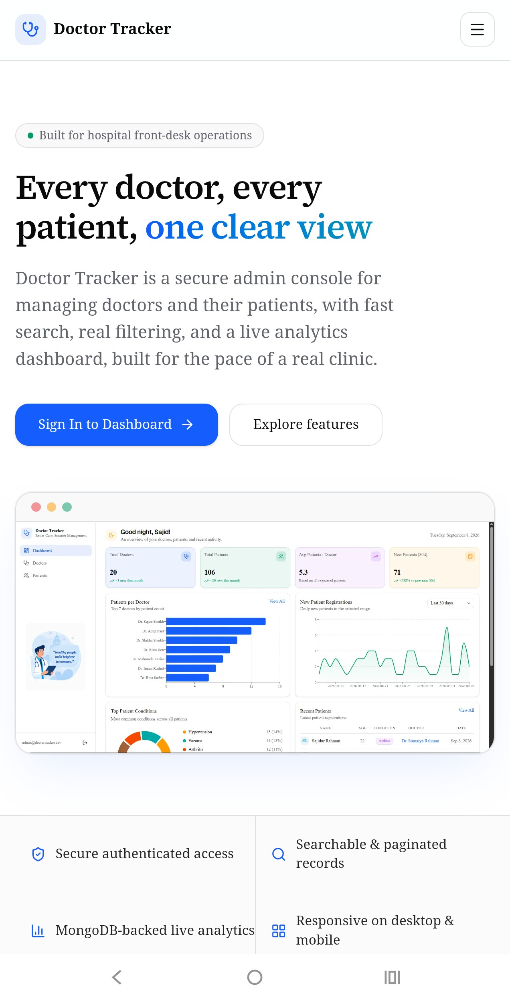</td>
<td align="center">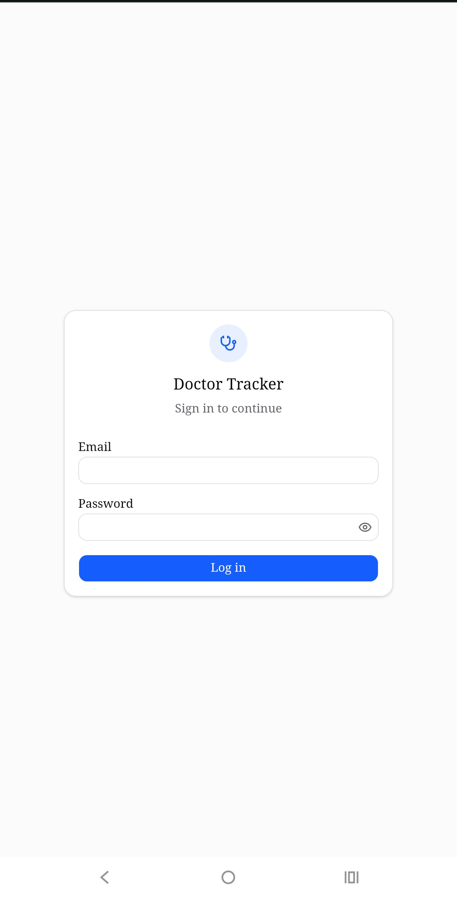</td>
<td align="center">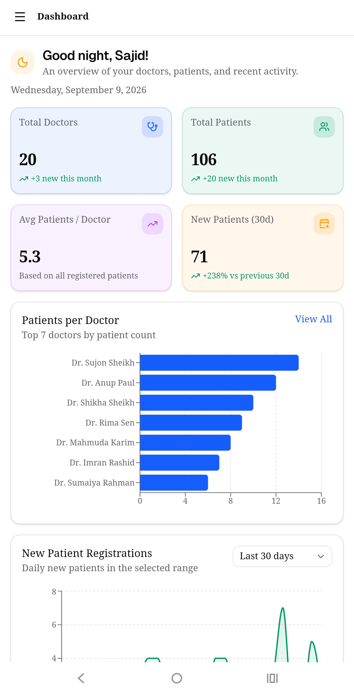</td>
</tr>
<tr>
<td align="center">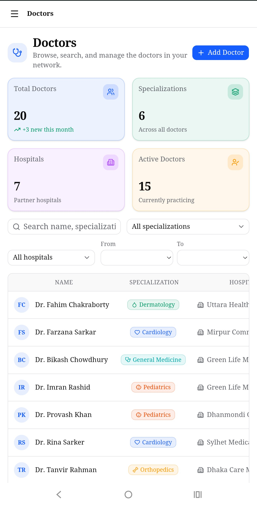</td>
<td align="center">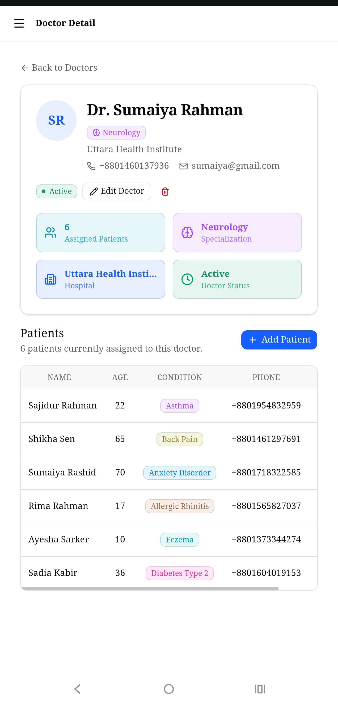</td>
<td align="center">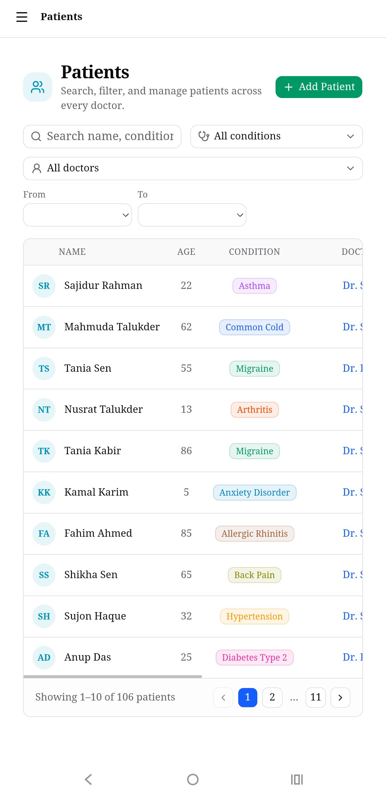</td>
</tr>
</table>

</details>


## ◈ Architecture

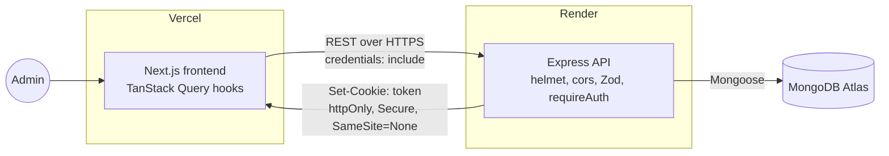

**API routes:** `/api/auth` (login, logout, me), `/api/doctors` (CRUD plus `/:id/patients`), `/api/patients` (list, create, update, delete) and `/api/dashboard/summary?range=7d|30d|90d`. Every route except login requires a valid session.

**Why the backend is the only auth boundary:** the frontend and API live on different domains, so a cookie set by the API is invisible to the frontend's own server. There is deliberately no Next.js `middleware.ts`. The dashboard route guard only redirects for UX, and the real check is `requireAuth` on every protected API route.

**Dashboard queries:** all fields come from independent indexed Mongoose queries run with `Promise.all` instead of one `$facet` pipeline. A shared date filter in `$facet` would have wrongly scoped the all-time totals to the selected range.

<details>
<summary><b>Indexes</b></summary>

| Collection | Index | Purpose |
| :--- | :--- | :--- |
| `doctors` | text on name, specialization, hospital | Search |
| `doctors` | `specialization`, `hospital`, `createdAt` | Filters and default sort |
| `patients` | text on name, condition | Search |
| `patients` | compound `doctorId` and `createdAt` | A doctor's paginated patient list |
| `patients` | `condition`, `createdAt` | Filters |

</details>


## ◈ Tech Stack

| Layer | Technologies | Purpose |
| :--- | :--- | :--- |
| Frontend | Next.js App Router, React 19, TypeScript | Client-rendered admin console |
| UI and state | Tailwind CSS 4, shadcn/ui, TanStack Query, React Hook Form, Zod, Recharts | Styling, server state, forms and charts |
| Backend | Node.js, Express 4, TypeScript | REST API |
| Data | MongoDB Atlas, Mongoose | Doctors, patients and users |
| Security | JWT, bcryptjs, helmet, cors, express-rate-limit | Sessions and hardening |
| Testing | Jest, Supertest, mongodb-memory-server, Testing Library | API and component tests |
| Hosting | Vercel (frontend), Render (backend) | Separate deployments |


## ◈ Getting Started

**Prerequisites:** Node.js 20 or newer and a MongoDB connection string (an Atlas free tier works).

```bash
git clone https://github.com/Saji-d/doctor-tracker.git
cd doctor-tracker
```

Backend:

```bash
cd backend
npm install
cp .env.example .env     # then fill in the variables below
npm run seed             # admin user and sample data (idempotent)
npm run dev              # http://localhost:4000
```

Variable names for `backend/.env`: `MONGODB_URI`, `PORT`, `ADMIN_EMAIL`, `ADMIN_PASSWORD`, `JWT_SECRET`, `FRONTEND_URL`, `NODE_ENV`.

Frontend (second terminal):

```bash
cd frontend
npm install
cp .env.example .env.local   # NEXT_PUBLIC_API_URL=http://localhost:4000/api
npm run dev                  # http://localhost:3000
```

Run the tests with `npm test` inside `backend/` or `frontend/`. See [`backend/README.md`](backend/README.md) and [`frontend/README.md`](frontend/README.md) for deeper write-ups.


## ◈ Project Structure

<details>
<summary><b>Show the tree</b></summary>

```text
doctor-tracker/
├── backend/
│   ├── __tests__/        # Jest and Supertest suites
│   └── src/
│       ├── controllers/  # auth, doctors, patients, dashboard
│       ├── middleware/   # auth, validation, errors
│       ├── models/       # User, Doctor, Patient
│       ├── routes/
│       ├── services/     # business logic and aggregation
│       ├── validators/   # Zod schemas
│       └── scripts/seed.ts
├── frontend/
│   └── src/
│       ├── app/          # (auth) and (dashboard) route groups
│       └── components/   # charts, data-table, filters, forms, ui
└── docs/screenshots/
```

</details>


## ◈ Roadmap

- [x] Doctor and patient CRUD with search, filters and pagination
- [x] Analytics dashboard with trend comparison
- [x] Cookie-based auth with a rate-limited login
- [x] Backend and frontend test suites
- [ ] Role-based accounts beyond the single seeded admin
- [ ] Keep-alive or paid hosting to remove the free-tier cold start


## ◈ Author

**Sajidur Rahman Sajid**, Full-Stack Developer and AI engineer from Dhaka.

[Portfolio](https://www.sajidur.me) · [LinkedIn](https://www.linkedin.com/in/sajidur-rahman-sajid/) · [GitHub](https://github.com/Saji-d) · [Email](mailto:sajidsajidurrahman99@gmail.com)

<div align="center"><sub>Built as a full-stack assessment project and deployed end to end.</sub></div>
